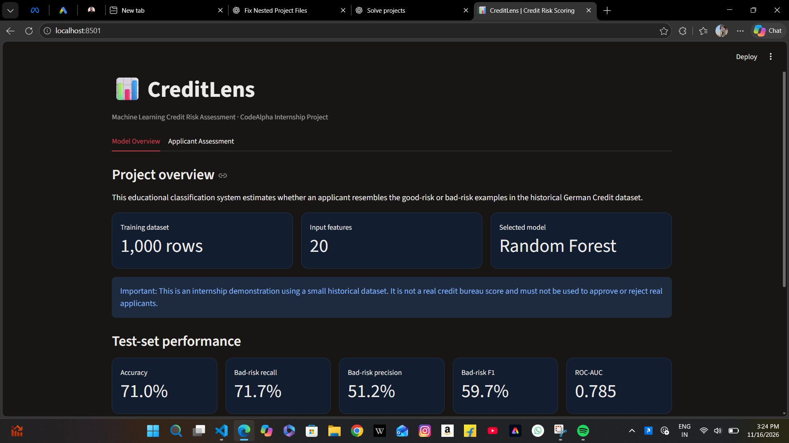
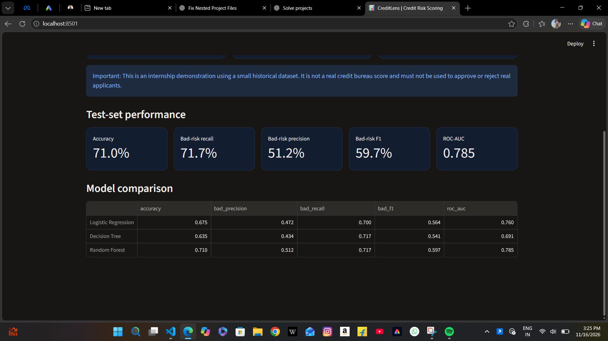
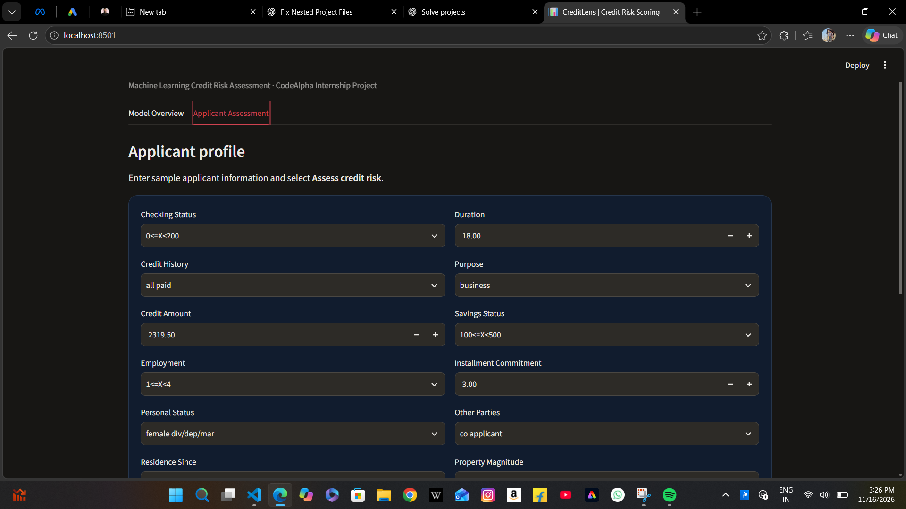
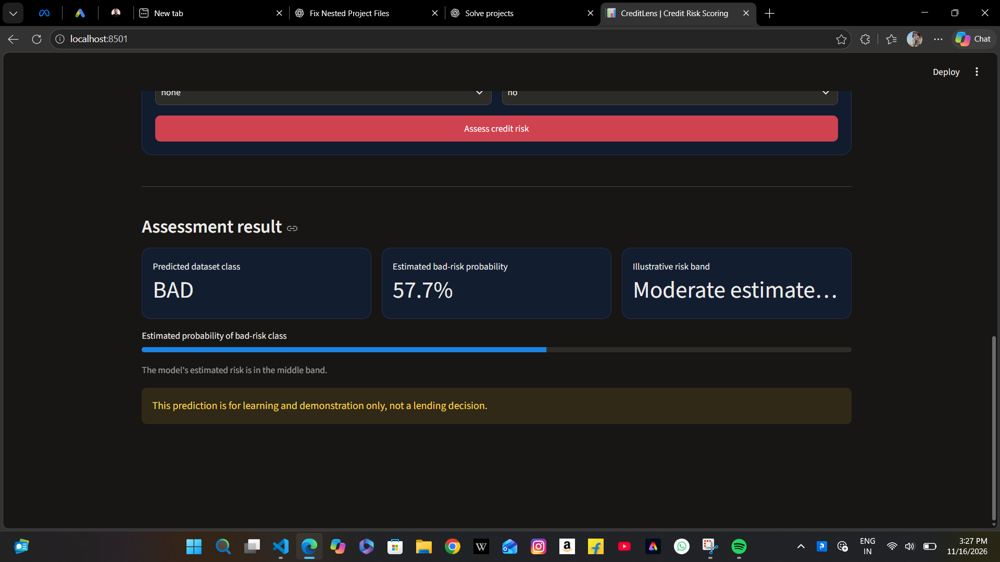

# CreditLens

<p align="center">
  <strong>Machine Learning-Based Credit Risk Assessment</strong>
</p>

<p align="center">
  
  
  
  
</p>

CreditLens is an educational end-to-end machine learning project that estimates credit risk using the Statlog (German Credit Data) dataset. It compares classification models, evaluates their performance, and presents applicant assessments through an interactive Streamlit dashboard.

## Objective

Train and compare classification models to predict the `good` or `bad` credit-risk label. The project includes preprocessing, model comparison, evaluation metrics, a saved pipeline, and an interactive Streamlit application.

## Dataset

- **Dataset:** Statlog (German Credit Data), distributed through OpenML as `credit-g`
- **Original source:** UCI Machine Learning Repository
- **Size:** 1,000 records and 20 input features
- **Target:** `good` or `bad`
- **Dataset reference:** https://archive.ics.uci.edu/dataset/144/statlog-german-credit-data
- **OpenML reference:** https://www.openml.org/d/31

The dataset documentation includes a cost matrix: incorrectly classifying a bad-risk applicant as good has a higher stated cost than the reverse. For this reason, model selection reports and prioritizes recall for the `bad` class, with ROC-AUC as a tie-breaker. This is a teaching choice, not a production lending policy.

## Tech stack

Python, Pandas, NumPy, Scikit-learn, Joblib, Streamlit.

## Application screenshots

### CreditLens model overview and evaluation





### Applicant assessment





## Project structure

```text
CodeAlpha_CreditScoringModel/
├── app.py
├── train.py
├── requirements.txt
├── README.md
├── .gitignore
├── models/
│   └── (generated model artifact)
├── reports/
│   └── (generated metrics and feature metadata)
└── tests/
    └── test_smoke.py
```

## Setup (Windows PowerShell)

```powershell
py -3.11 -m venv .venv
.\.venv\Scripts\Activate.ps1
python -m pip install --upgrade pip
pip install -r requirements.txt
```

If PowerShell blocks activation, run this once in the current terminal:
```powershell
Set-ExecutionPolicy -Scope Process -ExecutionPolicy Bypass
```

## Train and evaluate

```powershell
python train.py
```

The script downloads the OpenML dataset, creates a stratified 80/20 train/test split, compares Logistic Regression, Decision Tree, and Random Forest using 5-fold stratified cross-validation on the training split, then evaluates the selected model once on the untouched holdout test split. The model, feature metadata, and evaluation reports are generated locally.

## Launch the app

```powershell
streamlit run app.py
```

## Testing

```powershell
python -m unittest discover -s tests -v
```

Run training before the smoke test because tests load the generated model and reports. GitHub Actions repeats training and testing on pushes and pull requests.

## Evaluation

The report includes accuracy, precision, recall and F1-score for the `bad` class, ROC-AUC, a confusion matrix, and a model comparison.

## Responsible-use note

This dataset is small, historical, and not representative of modern lending populations. It contains sensitive applicant attributes. The app is an educational demonstration only; it must not be used for real credit decisions or to determine a person's eligibility for financial products.
